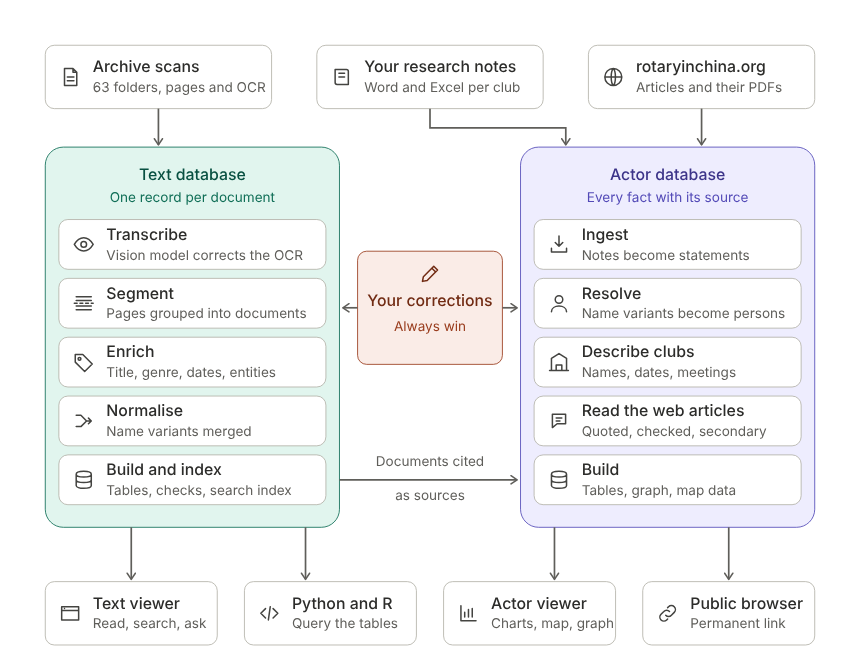
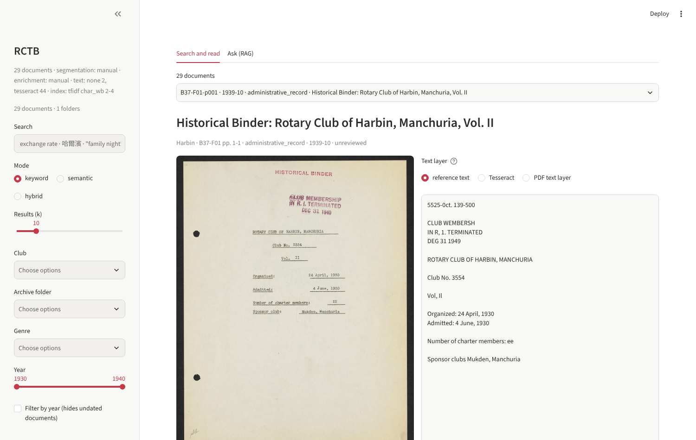
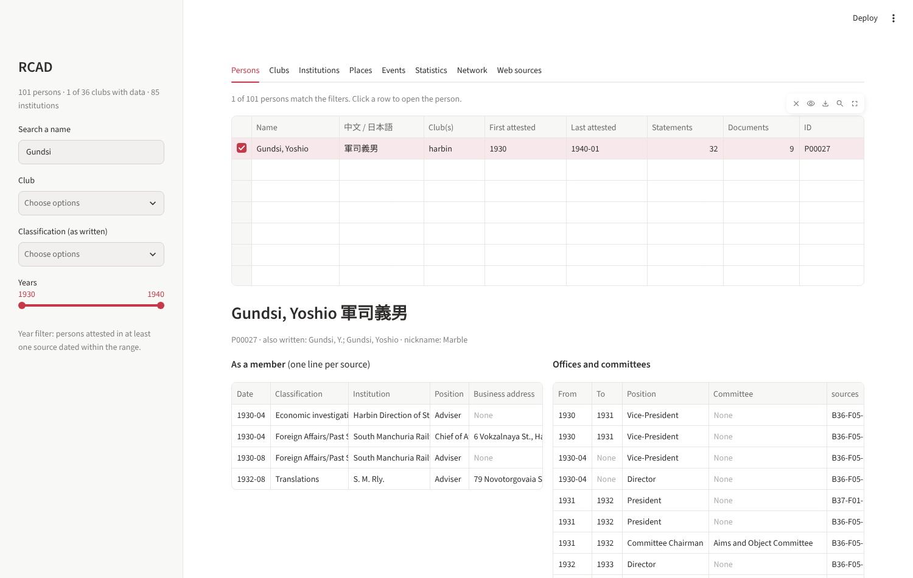
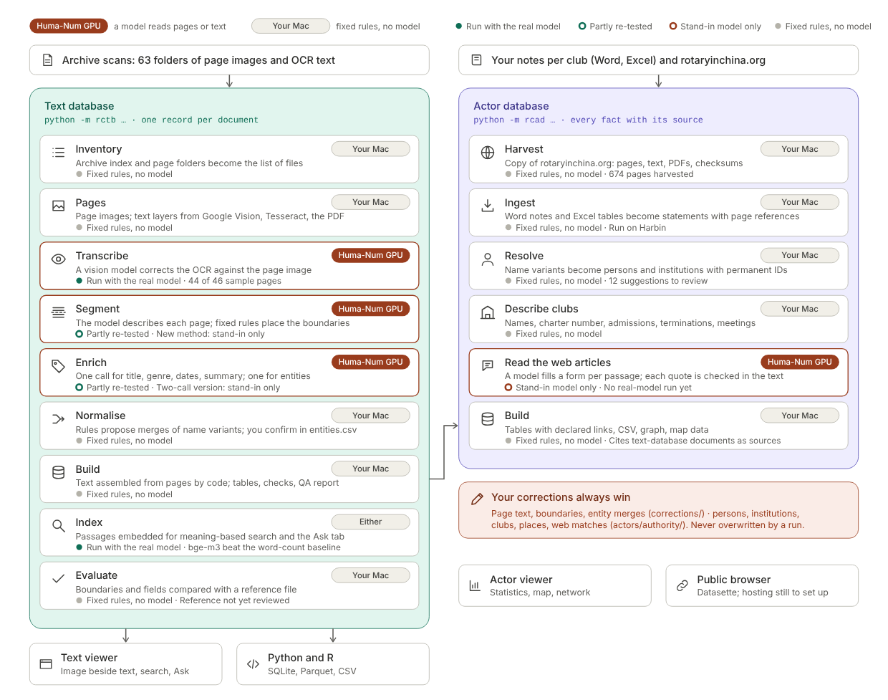

# Rotary in China: from archive scans to linked databases

A transparent, repeatable workflow that turns the archives of the Rotary clubs in China and Manchuria
(1919–1952) into two linked databases:

- a **text database** (`rctb`): one record per document (letter, roster, report, clipping), with its
  verbatim text, metadata, named entities and page images;
- an **actor database** (`rcad`): persons, clubs, institutions and places, where every fact keeps a
  reference to the archive page or web article it comes from.

**This repository is the sample edition.** It contains the full code and documentation, and the data
of one pilot folder only: the second volume of the Harbin club's records (`B37-F01`, 46 pages,
1936–1940) and the research notes on that club. Everything below runs on that sample.



## Try it in five minutes

No language model and no GPU are needed for this: the sample's intermediate results are included.

```bash
git clone <this repository>
cd rotary-in-china
python -m venv .venv && source .venv/bin/activate
pip install -r requirements.txt

python -m rctb build          # text database   -> data/out/rctb.sqlite   (29 documents, 46 pages)
python -m rctb embed          # search index
python -m rcad all            # actor database  -> actors/out/rcad.sqlite (101 persons, 85 institutions)
python -m pytest -q tests     # 17 tests

streamlit run app/app.py      # text viewer: page image beside text, search, questions
streamlit run app/actors.py   # actor viewer: persons, clubs, statistics, map, network
python examples/query_python.py
```

| Text viewer | Actor viewer |
|---|---|
|  |  |

## What is in the repository

```
rctb/                 text database pipeline        python -m rctb <stage>
rcad/                 actor database pipeline       python -m rcad <stage>
app/                  the two viewers (Streamlit) and the network view
prompts/              every instruction given to a model, as plain Markdown files
config*.yaml          settings: default, local model (Ollama), Huma-Num GPU, vLLM
corrections/          hand corrections to the text database; always win over machine output
gold/                 reference segmentation of the sample folder, for scoring
schema/               JSON Schema of a document record
scripts/              harvest_rotaryinchina.py: polite, resumable copy of rotaryinchina.org
hpc/, notebooks/      running the model steps on the Huma-Num / CC-IN2P3 GPU platform
examples/             querying the databases from Python and R
tests/                unit tests
docs/                 documentation of both databases, pipeline diagrams
data/raw/             the archive index; put scans here (see data/raw/README.md)
data/work/            intermediate results of the sample (page texts, segmentation, enrichment)
data/out/             the sample text database, page images, search index, QA report
actors/sources/       research notes on the Harbin club (Word + Excel)
actors/authority/     tables you edit: persons, institutions, clubs, places, classifications
actors/out/           the sample actor database, CSV exports, graph export
```

## The two pipelines

**Text database.** `inventory → pages → transcribe → segment → enrich → normalize → build → embed`,
then `evaluate` against the reference. A vision model corrects the existing OCR against the page
image; pages are grouped into documents; each document is described; name variants are merged with
your approval; code assembles the records and runs checks.
Details: [docs/text_database.md](docs/text_database.md).

**Actor database.** `ingest → resolve → build`, plus `web` for the articles of rotaryinchina.org.
Research notes become statements as written in the source; name variants are resolved into persons
and institutions with permanent identifiers; clubs are described by dated statements.
Details: [docs/actor_database.md](docs/actor_database.md).



## Principles

1. **The page is the ground truth, the document is the unit.** A document's text is assembled by
   code from its pages' texts; a model never rewrites it.
2. **Every fact keeps its source**, down to the archive page (`B37-F01-p003`) or the web article.
3. **Corrections always win.** They live in plain files (`corrections/`, `actors/authority/`) and
   are re-applied at every run.
4. **Checks flag, they do not fix.** See `data/out/qa_report.md` and `actors/work/input_report.md`.
5. **Every model call is cached** under a fingerprint of its input: runs resume, repeat at no cost,
   and can be traced. Prompts are files.
6. **Open formats and stable identifiers.** SQLite, CSV, Parquet; `B37-F01-p008`, `P00027`.

## Running the model steps

Only four steps use a language model: `transcribe`, `segment`, `enrich` (text database) and `web`
(actor database). Choose a backend in a config file and pass it with `--config`:

| Config | Backend |
|---|---|
| `config.yaml` | Anthropic API (set `ANTHROPIC_API_KEY`), or `backend: none` to use cached results only |
| `config.local.yaml` | a local model served by Ollama |
| `config.hpc.yaml` | Ollama on the Huma-Num / CC-IN2P3 GPU platform; see [hpc/README.md](hpc/README.md) and the notebook |
| `config.vllm.yaml` | any OpenAI-compatible server (vLLM) |

```bash
python -m rctb all --config config.hpc.yaml --files B37-F01     # the sample folder only
python -m rctb evaluate gold/B37-F01.yaml
```

To run the steps that read scans (`pages`, `transcribe`) you need the page images of the folder,
which are not stored here in full resolution: see [data/raw/README.md](data/raw/README.md).

## State of the work (16 November 2026)

| Part | State |
|---|---|
| Text database on the sample: build, search, viewer, tests | Working; the 29 sample records were annotated in a chat session and are **not yet reviewed by a historian** |
| Transcription with a vision model (qwen3.5:35b on Huma-Num) | Run on the sample: 44 of 46 pages |
| Segmentation and enrichment | A first version was run on the sample (22 documents found, 29 in the reference). The reworked versions are tested only against a stand-in model |
| Actor database on the Harbin notes | Working: 101 persons, 85 institutions, 109 membership and 381 office statements; 12 suggested matches to review |
| Reading the web articles (`rcad web`) | Tested only against a stand-in model |
| Public browser (Datasette) | Configuration included (`actors/datasette.yaml`); not yet hosted |
| `examples/query_R.R` | Written, not executed |

## Data, rights and what is not included

- **Archive scans.** The sample page images in `data/out/images/` are reduced-size reproductions of
  archive pages. Check the terms of the holding archive before making this repository public or
  reusing them.
- **rotaryinchina.org.** The harvest script is included; the harvested pages and PDFs are not
  (`actors/web/` is ignored by Git), pending the site owners' answer on reuse.
- **The other 62 folders** are not included in this edition.

## Citing, licence, contact

Author: Cécile Armand. A licence has not been chosen yet: until one is added, the usual default
applies (all rights reserved). A common choice for research projects is an open-source licence for
the code and a Creative Commons licence for the data.
